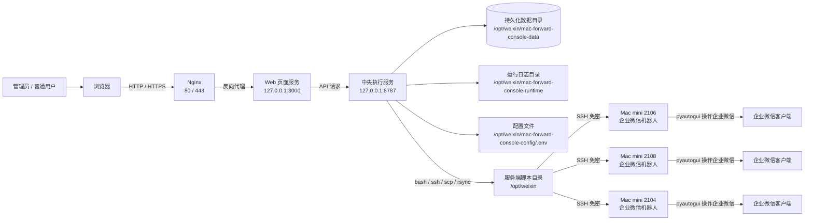
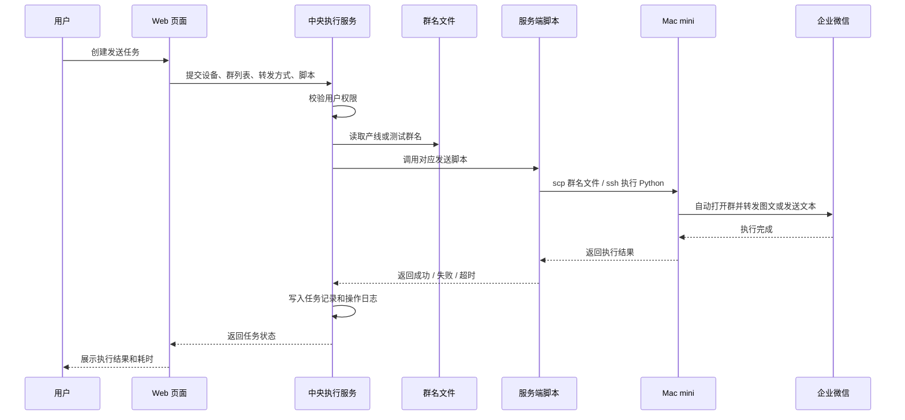
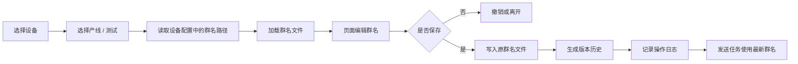
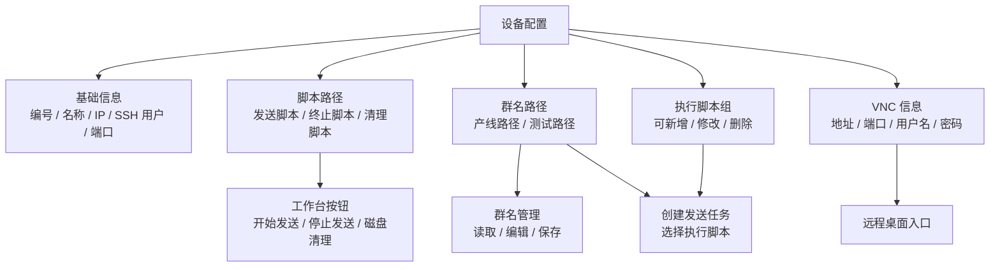
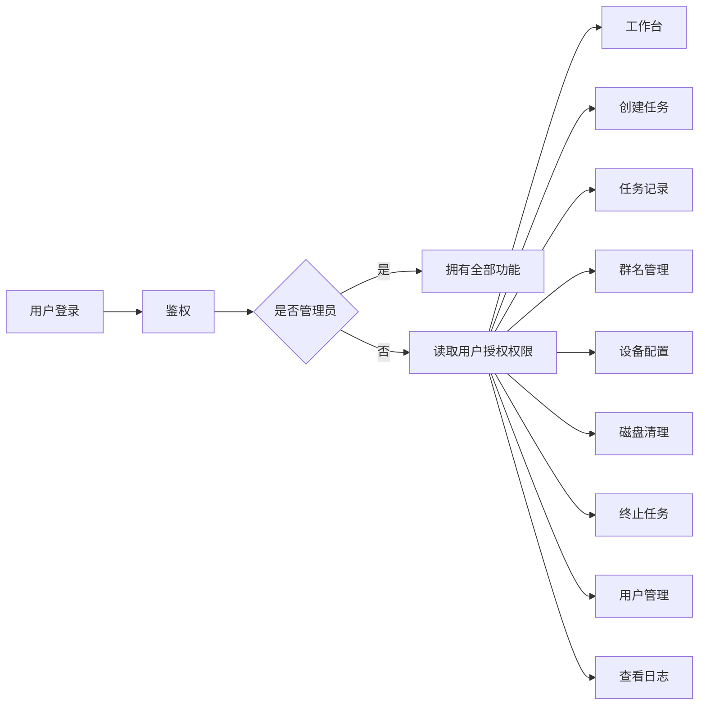
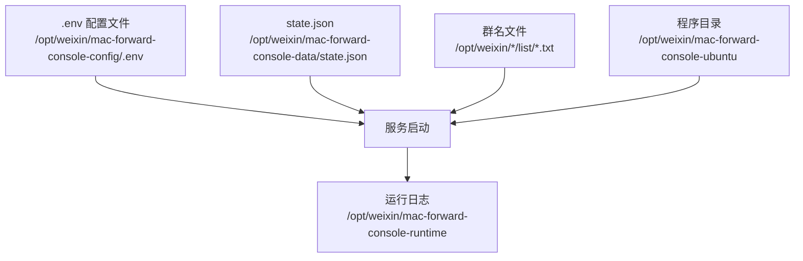

# 架构说明

本文用于项目交接、部署说明和后续维护。当前系统定位为“机器人中控台”，通过 Web 页面统一管理 Mac mini 设备、群名文件、发送任务、脚本执行、操作日志和用户权限。

## 1. 系统架构图



说明：

- 用户只通过浏览器操作，不需要登录服务器执行命令。
- Nginx 负责域名、SSL 和反向代理。
- Web 页面服务负责页面展示和交互。
- 中央执行服务负责登录鉴权、设备配置、任务调度、脚本调用、日志记录和数据持久化。
- Mac mini 不需要部署 Web 服务，只保留企业微信、Python 自动化环境和远程登录能力。

## 2. 功能模块图

```mermaid
flowchart TB
    Console[机器人中控台] --> Dashboard[工作台]
    Console --> Send[发送中心]
    Console --> Groups[群名管理]
    Console --> Devices[设备管理]
    Console --> Messages[发送信息管理]
    Console --> Records[任务记录]
    Console --> Settings[设置]

    Dashboard --> D1[设备运行状态]
    Dashboard --> D2[最近任务]
    Dashboard --> D3[操作日志]
    Dashboard --> D4[一键清理 / 一键发送 / 一键停止]

    Send --> S1[立即发送任务]
    Send --> S2[定时发送任务]
    Send --> S3[单台设备发送]
    Send --> S4[多台设备同时发送]
    Send --> S5[选择产线 / 测试群列表]
    Send --> S6[选择图文转发 / 指定文本发送]
    Send --> S7[选择执行脚本组]

    Groups --> G1[按设备维护群名]
    Groups --> G2[产线群名]
    Groups --> G3[测试群名]
    Groups --> G4[搜索 / 单行编辑]
    Groups --> G5[批量新增 / 批量删除]
    Groups --> G6[首行 / 底部群名]
    Groups --> G7[版本历史 / 预览 / 恢复 / 删除]

    Devices --> V1[设备基础信息]
    Devices --> V2[SSH 连接配置]
    Devices --> V3[发送 / 终止 / 清理脚本]
    Devices --> V4[产线 / 测试群名路径]
    Devices --> V5[VNC 远程桌面信息]
    Devices --> V6[执行脚本组]

    Messages --> M1[文本消息新增]
    Messages --> M2[文本消息编辑]
    Messages --> M3[文本消息删除]

    Records --> R1[任务状态]
    Records --> R2[任务耗时]
    Records --> R3[日期筛选]
    Records --> R4[全屏查看]
    Records --> R5[删除单条 / 删除全部]

    Settings --> A1[用户与权限]
    Settings --> A2[管理员密码]
    Settings --> A3[系统设置]
    Settings --> A4[服务状态]
    Settings --> A5[操作日志管理]
```



## 3. 发送任务流程图



## 4. 群名管理流程图



说明：

- 产线群名和测试群名分别绑定独立文件路径。
- 每台设备的群名文件独立维护，不能串用。
- 新增群名不会自动删除重复项，只提示重复，由管理员手动处理。
- 如果设置了底部群名，新增内容会插入到底部群名上方。

## 5. 设备配置关系图



## 6. 权限模型



说明：

- 管理员拥有全部权限。
- 普通用户只能看到已授权菜单和操作按钮。
- 群名维护人员可单独授权“群名管理”权限。
- 用户权限保存在持久化数据目录中，升级代码不会丢失。

## 7. 持久化和配置模型



建议：

- 程序目录可以随版本替换。
- 配置目录、数据目录、运行日志目录和群名文件目录不要放在程序发布目录里。
- 这样升级版本时不会丢失设备配置、用户权限、任务记录、操作日志和群名文件。

## 8. 备份与同步架构图

```mermaid
flowchart LR
    A[主服务器<br/>192.168.1.77] --> B[本地备份目录<br/>/opt/weixin/mac-forward-console-backups]
    B -->|保留 30 天| C[自动清理旧备份]
    B -->|scp 最新备份| D[备份服务器<br/>192.168.1.88]

    A -->|rsync 群名文件| E[备用服务器 / 目标服务器<br/>192.168.1.88]
    E --> F[/opt/weixin/csmac2106/list/schoollist.txt]
    E --> G[/opt/weixin/csmac2108/list/schoollist.txt]
    E --> H[/opt/weixin/aotmac2104/list/schoollist.txt]
```

相关脚本：

```text
deploy/simple/backup-console.sh
deploy/simple/scp-latest-backup.sh
deploy/simple/sync-group-files.sh
```

## 9. 关键路径清单

```text
程序目录：
/opt/weixin/mac-forward-console-ubuntu

配置目录：
/opt/weixin/mac-forward-console-config/.env

数据目录：
/opt/weixin/mac-forward-console-data

运行日志：
/opt/weixin/mac-forward-console-runtime

常用脚本：
/opt/weixin/clean-mac-remote.sh
/opt/weixin/clean2106.sh
/opt/weixin/clean2108.sh
/opt/weixin/clean2104.sh

2106 群名：
/opt/weixin/csmac2106/list/schoollist.txt

2108 群名：
/opt/weixin/csmac2108/list/schoollist.txt

2104 群名：
/opt/weixin/aotmac2104/list/schoollist.txt
```

